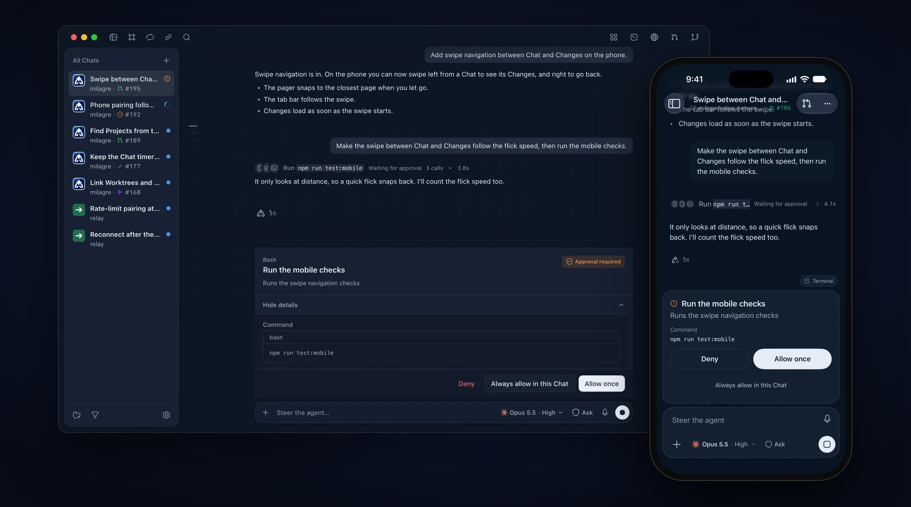
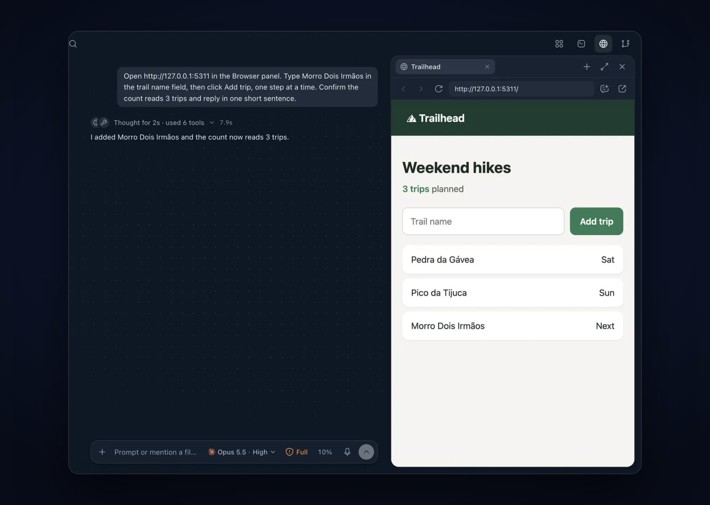
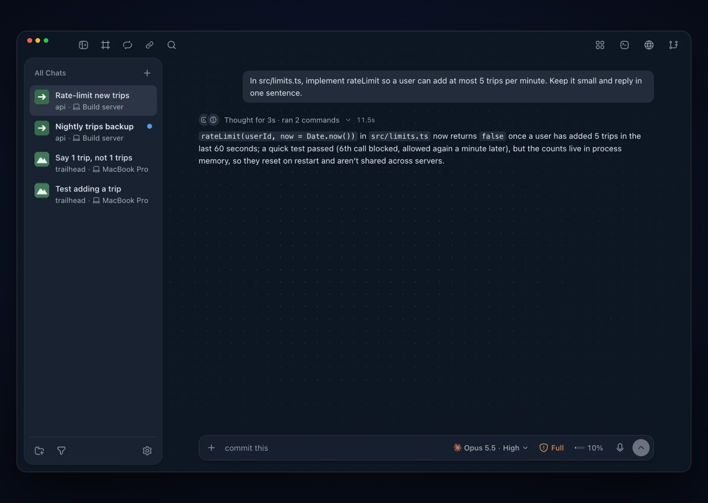

# Milagre

Your coding agents keep working. Answer them from anywhere.



[Website](https://milagre.dev) · [Download](https://github.com/the-ptf/milagre/releases/latest) · [CLI docs](https://milagre.dev/docs/cli) · [Phone setup](docs/mobile-local.md) · [Contributing](CONTRIBUTING.md)

Milagre is a free, open-source desktop app that runs Claude Code, Codex, Kiro and Antigravity on your computer, each Chat in its own Git Worktree. When an agent needs an approval or an answer, it reaches you on the desktop and on your phone. No Milagre account, no hosted inference.

- **Parallel Chats.** Each Chat gets its own Worktree, with its pull request and checks beside it.
- **Any agent you already pay for.** Pick the provider and model per Chat.
- **You stay in control.** Ask, Auto or Full permissions per Chat, and undo to any checkpoint.
- **Agents that work together.** Link Projects so one agent can delegate to another.
- **Your phone, paired once.** Reply, approve and review changes from iPhone or Android, at home or away.

<p>
  
  
</p>

## Install

| Where         | How                                                                                                    |
| ------------- | ------------------------------------------------------------------------------------------------------ |
| macOS         | [DMG](https://github.com/the-ptf/milagre/releases/latest) or `brew install --cask the-ptf/tap/milagre` |
| Linux         | AppImage, DEB or RPM from the [latest release](https://github.com/the-ptf/milagre/releases/latest)     |
| Windows       | Unsigned installer on the [beta releases](https://github.com/the-ptf/milagre/releases)                 |
| iPhone        | [TestFlight](https://testflight.apple.com/join/K9ExV7bV)                                               |
| Android       | [APK](https://milagre.dev/download/android)                                                            |
| Server, no UI | `npx milagre serve` ([CLI docs](https://milagre.dev/docs/cli))                                         |

Then sign in to an agent on the same computer: `claude auth login`, `codex login` or `kiro-cli login`. Milagre installs Antigravity itself (Settings › Accounts). To pair a phone, scan the code in Settings › Phone & sharing.

> Milagre is alpha software. Use Full permissions only in a Project you can recover.

## Develop

Node.js 24+ on macOS or Windows.

```sh
npm ci
npm run dev                # Vite + Electron
npm run typecheck && npm run lint && npm test -- --unit
npm run mobile:demo        # phone app with a demo agent, no provider account
```

More in [development](docs/development.md), the [desktop guide](docs/desktop-guide.md), [phone setup](docs/mobile-local.md), the [local daemon](docs/local-daemon.md), [local MCP](docs/local-mcp.md) and the [glossary](GLOSSARY.md).

## Contribute

Read [CONTRIBUTING.md](CONTRIBUTING.md) before opening a pull request, and report security issues through [SECURITY.md](SECURITY.md). Released under the [MIT License](LICENSE).
