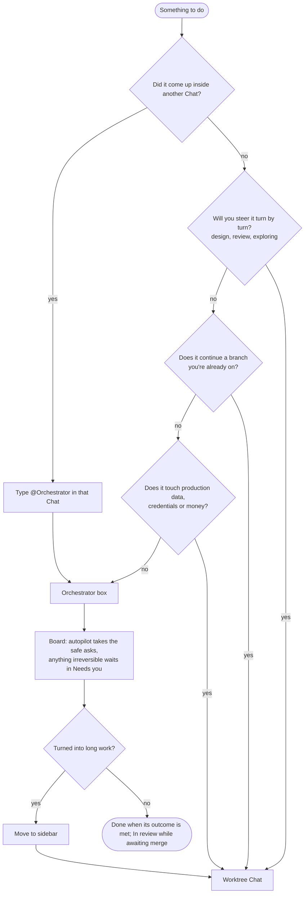

# Orchestrator

An Experimental box (Settings › Church › Orchestrator) that takes any request, picks the Project, role, model, account and
computer for it, and runs it as a task Chat tracked on a board. Each computer's host owns its own Orchestrator in
`orchestrator.json` (settings, tasks, owner memory); the desktop and phone read it with `orchestrator:read` and follow
`orchestrator:changed` (the phone gets the `orchestrator` signal).

## Task Chats are hidden Chats, not Subchats

A Subchat's parent must be in its own Project, and the Orchestrator spans every Project, so a task Chat is a normal Chat
marked `session.orchestrator = { taskId, hidden }`. `isHiddenTaskChat` keeps it out of every Chat list while `hidden`;
Move to sidebar clears the flag. It is the Run Chat pattern, with no "shown while waiting" exception: a task that needs
the owner shows in Needs you on the board instead.

## Moving and deleting tasks

The owner can move a task to another column by hand: drag its card, or pick Move to from its menu (the card's ⋯ button
or right-click on desktop, the task sheet on the phone). `orchestrator:task:move` stores the column on the task Chat as
`session.orchestrator.column`, where `placedColumn` makes it win over the derived one, until the Chat's next
`turn-started` clears it like `blocked`. Done is not stored there: moving to Done marks the Chat Done, and moving out of
Done clears that mark. A task held in a column the owner picked is never swept.

Delete task (card menu and task header on desktop, task sheet on the phone) runs `orchestrator:task:delete`: it deletes
the task's Chat through `chat:delete` (which stops its agent) and drops the task. When the delete fails the Chat is
archived instead, so a hidden task Chat is never left behind. Its Worktree and branch stay. Desktop waits out the usual
Undo toast first; the phone asks to confirm. A task on another computer forwards both commands to it.

## Routing

`orchestrator/router.cjs` asks the router model (Haiku by default) for a Project, role and title over each Project's hints
(its AGENTS.md, CLAUDE.md or README, or hints the owner typed) and the owner memory. When the model is missing, slow or
names a Project that isn't listed, keyword matching on names and hints decides. With no Project, the task waits in Needs you
unless Settings say Best guess.

The role sets provider, model and effort. The account is the least used one under its limit, pinned on the task Chat as
`orchestrator.accounts[provider]`: `startAgentTurn` resolves it through `taskAccounts` in `runtime/orchestrator-wiring.cjs`
instead of the Project's account, and the limit-resume check compares against it too. Every task gets its own Worktree; when
making one fails it runs in the Project folder.

## Computers

With Use other computers on and Drive other computers on (Settings › Phone & sharing), the host asks each paired computer
for `orchestrator:capacity` (CPU, free memory, busy Chats, Projects by Git origin) and, when another computer has the same
Project with more room, starts it there with `orchestrator:start-here`. The local task keeps `remoteComputerId` and
`remoteTaskId`; Move to sidebar and Undo go to that computer. That computer's own Orchestrator settings decide its autopilot.

## Completion

Settings › Church › Orchestrator › Completion sets the required outcome for new tasks: **PR created** (the default),
**PR merged**, or **Agent finished** for requests that need no PR. Each task records the selection when sent, before
routing, so later settings edits, rerouting, account fallback and placement on another computer cannot change its
requirement. The receiving computer keeps the sender's outcome while using its own autopilot settings. Agents can
change the default through `orchestrator_outcome`, backed by `orchestrator:settings:save` like both Settings screens.

Completion › Permission mode sets the mode new task Chats run in: Ask, Auto or Full, or **Same as new Chats** (the
default), which takes the sending device's default and Auto when an agent sends. `send` resolves it once, so a task
placed on another computer keeps the sender's mode. There is no MCP tool for it: an agent must not raise the mode of
the tasks it starts.

Every provider receives the outcome in its task prompt. The board verifies PR state through the host's GitHub reads;
a URL in a reply alone is insufficient. Ending a turn cannot bypass a PR requirement: missing PR evidence puts
finished work in Needs you, an open PR satisfies PR created but stays In review for PR merged, and a closed, unmerged
PR needs attention. Marking the task's Chat Done accepts it as it is, for work that turned out to need no PR. Tasks
saved before outcomes existed count as Agent finished, so upgrading doesn't move them. Running work, background tasks, approvals, failed turns and stopped turns take
precedence over completion. PR merged does not authorize an automatic merge: autopilot still asks the owner.

A turn that ends in prose can't say whether the work is finished, so a task's agent says it is blocked with the
`task_blocked` milagre tool, which only task Chats get (every provider; the task prompt tells it when). It stores
`session.orchestrator.blocked = { reason, at }` on the task Chat, not on the task, so a board reading the Chat from another
computer sees it too. While it is set the task waits in Needs you with "Blocked: reason" on its card and in the sidebar's
Orchestrator row (tooltip on desktop, subtitle on the phone), and the Done sweep leaves it alone. The next turn's
`turn-started` clears it; marking the Chat Done accepts the task as it is. Pending approvals, questions and secrets
(questions with `secret`) already hold a task in Needs you without the tool.

Tasks saved before this setting existed require PR created, so a reply without a verified PR no longer appears Done.
Without available PR evidence (including an unavailable computer), the board cannot infer successful completion.

## Autopilot

`orchestrator/autopilot.cjs` watches approvals and questions in task Chats and Routine Run Chats, and the approval steps of
flow Runs (`routines/flow-autopilot.cjs` hooks the flow's "waits for you" notice). In a Run, anything about design or UI waits
for the owner (`isDesignDecision`, then the router model's `design` verdict), so a flow only stops on taste and on what can't
be undone. A planned flow approval shows on the step until it lands; the step then says "Approved by autopilot". Anything `isIrreversible` (merging,
pushing to main or with force, deleting, deploying, publishing, paying, messaging someone) always waits for the owner.
Otherwise confidence and the owner's trust for that kind of decision pick: answer now, answer after the veto window, or ask.
A question is answered only with its listed options. The owner stepping in during the veto window cancels the answer and
counts as a correction; corrections weigh three times an answer in `trustScore`.

## Owner memory

The first run reads Claude Code, Codex, Antigravity and Kiro instruction and memory files on this computer and has the router
model keep durable notes; without a model it keeps bullet rules that say always, never, must or prefer. The owner can untick,
delete, read again or forget. Memory syncs across paired computers by `orchestrator:memory:merge`: the copy with the newer
`updatedAt` wins on both sides, so two computers editing at once keep the later one.

## Orchestrator or a Worktree Chat

Use the Orchestrator for self-contained work you hand off and check later; open a Chat in the Project's Worktree for work
you steer, that builds on a branch, or that you want to approve step by step.
