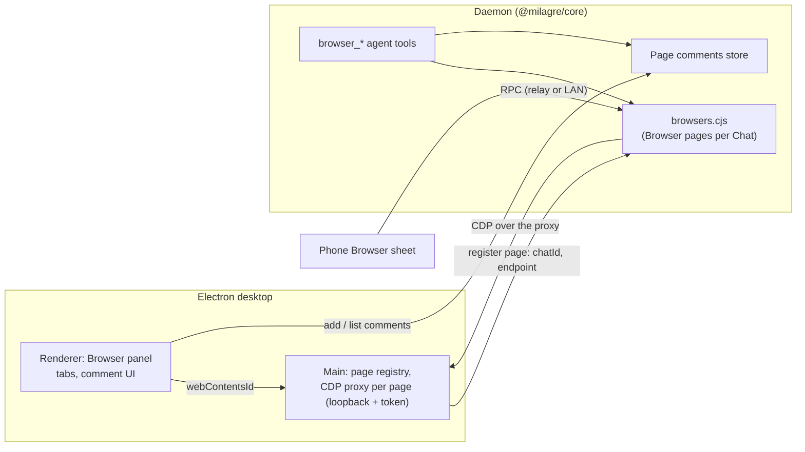

# Internal browser with page comments

Date: 2026-10-28. Modelled on Orca's browser and Design Mode, with Paseo's and T3 Code's browsers as second
references (research below).

## Intent

Today every web link, including the Chat's own dev server, opens in the system browser, and the only way to point at a
problem on a page is to describe it or paste a screenshot. The agent tests in its own separate Chrome. This adds a
browser inside Milagre: the Chat's pages open in a docked panel beside the transcript, the user clicks an element and
leaves a comment on it, and the agent receives the element (selector, HTML, styles, component, screenshot) with the
comment, fixes it, and resolves the comment. The agent can drive the same page the user sees, and the phone can view
and comment on it too.

Success: Victor runs `npm run dev` in a Chat, the page opens in the panel, he drops three comments on three elements,
presses Send, and the agent fixes them in one turn and resolves each pin, without Victor describing where anything is.

## Decisions (Victor, 2026-10-28)

- **Placement:** a docked right panel, **Browser**, beside Simulator and Designs, with tabs inside it.
- **Delivery:** like Design comments. Pins collect on the page, **Send n comments** sends one message, the host stores
  them, and the agent resolves them with a tool and a note.
- **Agent control:** Milagre's own `browser_*` tools, bound to the Chat.
- **Phone:** view and comment.
- **Page owner:** a desktop `<webview>`. The daemon brokers the agent tools and the phone to the desktop that holds the
  page. With the desktop app closed, the pages are gone.

## Goals

- A **Browser** panel per Chat: tabs, address bar, back/forward/reload, loading state, favicon and title. It docks and
  resizes like Simulator and is toggled from the panel corner (shortcut ⌘⇧B).
- The Chat's dev servers are one click away: Ports pill rows and web links in replies open in the panel.
- Settings › Browser › Open links in: Milagre browser (default) or Your browser, for every web link in replies and the
  Ports pill; ⌘-click opens the other one (Victor, 2026-10-29).
- One persistent sign-in session for every internal page (`persist:milagre-browser`), so logging in once is enough.
- **Comment mode** (C, or the toolbar button): hovering highlights the element under the pointer, a click opens a
  comment box anchored to it, and Add drops a numbered pin that follows the element as the page scrolls and resizes.
- A comment carries the page URL and title, the element's selector, DOM path, role and accessible name, text, an HTML
  snippet, the computed styles that matter, its box, its React component chain and source location when the page
  exposes them, and a cropped screenshot of the element. Values that look like secrets are redacted.
- A tray lists the page's pending comments (edit, delete) and **Send n comments** sends them as one message, rendered
  in the transcript as a card, the way design feedback is.
- The agent reads comments with `browser_comments` and resolves them with `browser_resolve_comment` and a note; the pin
  turns resolved on the page and in the card.
- Agent tools act on the Chat's Browser pages: open a page, snapshot (accessibility tree with refs), click, fill,
  type, press, select, hover, scroll, wait, navigate, screenshot, console, evaluate, close. They work on internal pages
  and on browsers attached under ADR-0006.
- The phone sees internal pages in the existing Browser sheet, sees their pins, and taps an element to comment on it.

## Non-goals

- Area selection, freehand drawing on a screenshot and live CSS editing (T3 Code has all three). Later, if pins prove
  out.
- Browser profiles, cookie import, being the OS default browser.
- Pages for Chats on another computer (the Computers sidebar). The panel opens only for Chats on this computer in v1.
- Pages that outlive the desktop app. Tools say the browser is not open instead.
- Firefox or Safari engines.

## Anti-goals

- A second copy of the page for the agent: the agent and the user act on the same page.
- The agent stealing the user's keyboard focus or moving the visible page while the user is typing into it.
- Comment pins in the agent's screenshots: the pin overlay hides while the agent captures.
- A DevTools endpoint any local process can drive: the CDP proxy is loopback-only and needs a per-launch token.
- Comments lost because the page navigated or reloaded: they live on the host, not in the page.

## How it fits together



- **The page is a `<webview>`** in the renderer, kept alive across Chat switches the way Paseo's resident webviews are:
  one fixed host layer, inactive surfaces parked off screen at their last size so the guest keeps running, the visible
  one positioned over the panel's slot by a ResizeObserver. A webview is never reparented (that replaces its guest).
- **Hardening:** `webviewTag: true` on the main window only; `will-attach-webview` forces `sandbox`,
  `contextIsolation`, `webSecurity`, strips any preload and allows only the `persist:milagre-browser` partition.
  Guests may navigate only to http(s) and `about:blank`; `window.open` becomes a new panel tab; downloads, permission
  requests and external protocols go through main's existing guards. The renderer CSP gains nothing: a webview guest
  is its own document, not a frame.
- **Main serves each page over CDP.** It attaches `webContents.debugger` and exposes a loopback WebSocket plus
  `/json/version` and `/json/list` (Orca's `CdpWsProxy`), on a random port behind a random per-launch token in the path.
  It registers each page with the daemon over the existing desktop socket: Chat id, page id, title, URL and endpoint.
- **The daemon treats it as one of the Chat's Browser pages** (ADR-0006: ownership by evidence; here the evidence is
  that the Chat's own panel opened it). `browsers-cdp.cjs` connects to the proxy like any other CDP browser, so
  screencast, input and the phone viewer work unchanged, and the new agent tools use the same adapter.
- **The comment picker is one script** in `packages/shared`, injected by the desktop with `executeJavaScript` in an
  isolated world and by the daemon with `Runtime.evaluate` (phone taps). It returns the captured element; the screenshot
  is a clip of `Page.captureScreenshot` (desktop: `capturePage`) with the overlay hidden.
- **Pins are drawn inside the page** by an isolated-world overlay with a closed shadow root, fed the Chat's comments for
  that URL. Because they are in the page they appear in the phone's screencast for free; they hide while an agent
  captures.
- **Comments live on the host**, beside the Chat's design comments, with the same caps (50 per send, 4000 characters
  each). A comment's screenshot is saved as a Chat attachment and sent as an image with the message.

## The message

One message per Send, grouped by page, parsed back into a card like `designFeedbackMessage`:

```
Comments on the page "Checkout" (http://localhost:5173/checkout):

1. (comment k3f9a2) <CheckoutForm> › <Button> button "Pay now", at src/Checkout.tsx:88: Make this full width on mobile.
   Selector: main > form > button.pay
   Box: 312×44 at 24,610 in a 390×844 viewport
   Styles: display: inline-flex; width: auto; padding: 12px 16px; font-size: 15px
   HTML: <button class="pay" type="submit">Pay now</button>

Each comment's screenshot is attached in order. Once you have addressed a comment, resolve it with
browser_resolve_comment and its comment id.
```

## Agent tools

Bound to the calling Chat, like the simulator tools; each takes an optional `page` (from `browser_list`), defaulting to
the Chat's active internal page.

| Tool                                           | Does                                                                                       |
| ---------------------------------------------- | ------------------------------------------------------------------------------------------ |
| `browser_open`                                 | Open a URL in a new or the active panel tab. Opens the panel only if the user has it open. |
| `browser_snapshot`                             | Accessibility tree with `@eN` refs; refs go stale on navigation (`stale_ref`).             |
| `browser_click`, `browser_fill`, `browser_type`, `browser_press`, `browser_select`, `browser_hover`, `browser_scroll` | Act on a ref after an actionability wait (visible, enabled, stable).                       |
| `browser_wait`                                 | For text, a ref, navigation or network idle, with a timeout.                               |
| `browser_navigate`                             | Back, forward, reload, or a URL.                                                           |
| `browser_screenshot`                           | Page or element, pins hidden.                                                              |
| `browser_console`                              | Recent console messages and page errors.                                                   |
| `browser_evaluate`                             | Run an expression in the page.                                                             |
| `browser_close`                                | Close a tab the agent opened.                                                              |
| `browser_comments`, `browser_resolve_comment`  | Read the Chat's page comments; resolve one with a note.                                    |

`browser_list`, `browser_attach` and `browser_detach` stay as they are and now list internal pages too. When the
desktop app is not running, every page tool returns "The Browser panel is not open on this computer". The bundled
`browser` skill gains the new tools and when to use them (use the user's page when they point at it; prefer it over a
separate headless Chrome for checking the Chat's own app).

## Phone

The Browser sheet lists internal pages with the others and streams them as today. A **Comment** button in the sheet
arms tap-to-comment: a tap runs the shared picker at that point over CDP, the sheet shows the captured element's label
and a text field, and Add stores the comment on the host. Pins show because they are in the page. Send works from the
phone's tray the same way. No native build: the sheet is the existing WebView receiver.

## Delivery plan

| PR | Scope                                                                                                                                    |
| -- | ---------------------------------------------------------------------------------------------------------------------------------------- |
| 1  | Browser panel on desktop: resident webviews, tabs, address bar, partition, hardening, Ports and localhost links open in it. No agent. |
| 2  | Page comments on desktop: shared picker script, comment box, in-page pins, tray, host store, message and card, `browser_comments` and `browser_resolve_comment`. |
| 3  | CDP proxy in main and page registration with the daemon: internal pages appear in the Browser pill and on the phone (view only).       |
| 4  | Agent `browser_*` tools over the adapter, bundled skill update.                                                                          |
| 5  | Phone comments: tap-to-comment in the Browser sheet, phone tray and Send.                                                                |

Designs are on the Chat's canvas (group Browser comments). Victor picked, 2026-10-28:

- **Send in the toolbar** (`browser-comment-a`): pending comments live as numbered pins on the page and a dark
  **Send n** button sits beside the comment toggle, as for Design comments. No tray.
- **No intent** on a comment (no fix / change / question chips): just the text.
- **Resolved pins stay** green with a check; hovering shows the agent's note (`browser-comment-sent`). The transcript
  card lists each comment with its element screenshot and status.

## Research

- **Orca** (`stablyai/orca`): `<webview>` per page in its tab/split system, `persist:orca-browser`. Grab and Annotate
  share an injected picker (closed-shadow overlay, `elementFromPoint` into open shadow roots); an anchored popover takes
  the comment and an intent (fix, change, question, approve); numbered pins render in the guest and follow scroll; a
  tray batches up to 20 and sends Markdown grouped by URL into the agent's terminal. Captures selector, DOM path, a11y,
  rects, 16 computed styles, 4 KB HTML, React fiber names and `_debugSource`, redacted twice. No screenshot on
  annotations. The agent drives the same webview through a CDP proxy on `webContents.debugger` and the `agent-browser`
  CLI. Phone views a stream; no annotations there. About 8k lines in `annotate/`.
- **Paseo** (`getpaseo/paseo`): `<webview>` workspace tab, `persist:paseo-browser`, resident webviews parked at 1×1.
  Annotate and screenshot-element modes; a picked element becomes a composer chip with a cropped screenshot and a
  `<browser-element>` text block. 18 MCP `browser_*` tools brokered from the daemon to the desktop that hosts the tab,
  ARIA snapshot refs with fingerprints. No mobile browser.
- **T3 Code** (`pingdotgg/t3code`): `<webview>` positioned over a slot by a lease, per-profile partitions; also a
  server-hosted headless Chrome streamed to web and mobile. A preload overlay with select, region, draw and erase tools
  and live CSS edits; the annotation is a composer chip sent as a `<context-envelope>`. `preview_*` MCP tools, with a
  claimed-tab rule for human versus agent control. Mobile views the server stream; no annotations there.
- **React 19** dropped `_debugSource`; source locations come from it only on older React or with a dev plugin, so the
  message omits `at file:line` when the page doesn't expose it.
